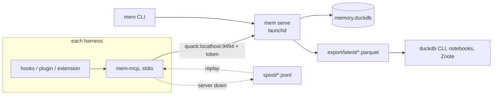

# agent-memory plan

One local, shared, auditable memory database for AI coding agents, built on
DuckDB 2.0. Every harness writes to the same append-only ledger, so for any
answer an agent gave you can ask: what was it shown, where did that come from,
and what did it do next.

Inspirations: Karpathy's "LLM wiki" idea (curated, human-readable memory that
compounds), duckbrain (DuckDB as an agent brain), and the episodic events /
profile facts / retrieval log split in `example-memory-db-schema.sql`.

## Scope

| Harness          | Tier | Integration           | Capture                                                     |
|------------------|------|-----------------------|-------------------------------------------------------------|
| Factory Droid    | A    | `hooks.json` + MCP    | Lifecycle and tool hooks in real time; assistant replies from the transcript file hooks point at. |
| Mistral Vibe     | A    | `hooks.toml` + MCP    | Tool hooks in real time; prompts and replies from the transcript file. No session or compaction hooks. |
| oh-my-pi (omp)   | A    | TypeScript hooks + MCP | Complete: every message, turn, tool, and compaction event, in process. |
| Amp              | B    | plugin API + MCP      | Complete per turn (`agent.end` carries every message); no compaction or session-end events. Threads also live server-side. |
| JetBrains Junie  | C    | MCP only              | Only what the agent logs through MCP tools. Sessions are `capture_completeness = 'partial'`. |

Out of scope: Letta Code. Deferred: Delta (Zed).

The tier is stored on `agents` and describes capability, not observed
coverage. Only Droid transcript import and Droid/Vibe hook payload adapters
are shipped; the wider table describes planned integrations.
`capture_observations` supplies bounded coverage evidence.
`session_summary` keeps recorded completeness separate from observed coverage.

## Runtime

- `mem serve` is the only process that opens `memory.duckdb`. It calls
  `quack_serve` on localhost, then locks itself down (below). It also writes a
  Parquet snapshot every 24 hours, because it holds the only connection.
- Clients attach with `ATTACH 'quack:localhost:9494' AS mem (TOKEN ...)` and
  run statements on the server. Many clients can write at once; each
  transaction is atomic across tables. Two kinds of client: harness hooks
  call the `mem` CLI directly (`mem event`, `mem ingest`; cold start to answer
  is about 110 ms, well inside Droid's 60 s default hook timeout), and
  `mem-mcp` exposes recall, remember, cite, and review to the agent
  mid-session. Both fall back to `spool/` when the server is unreachable.
- Admin work (migrations, direct export, `mem sql --direct`) opens the file
  directly and needs the server stopped. DuckDB's file lock enforces this and
  the CLI explains it.
- Parquet exports are the offline path: auditing, notebooks, and backups never
  need the server or the token.

Phase 0 numbers on this machine: about 4 to 5 ms per single-row insert over
Quack, measured by `mem smoke`.

## Data model (migration 0001)

Every table is append-only. Nothing is ever updated or deleted, so the
database is its own audit log.

Vocabulary (seeded by migrations, not writable by clients):
`agents`, `event_kinds`, `memory_types`, `memory_action_types`.

Ledger:

- `sessions`: one row per harness session, with agent, model, project, cwd,
  `capture_completeness`, and a `VARIANT` metadata column.
- `events`: everything that happened, ordered by `seq` within a session.
  Kinds include `user_msg`, `assistant_msg`, `system_context`, `tool_call`,
  `tool_result`, `memory_recall`, `memory_write`, `compaction`, `decision`,
  `outcome`, and `capture_error`. Large content goes to `blobs/` with
  `blob_ref`, `content_hash`, and `truncated`. `redactions` counts what the
  spool scrubbed. `parent_event_id` links results to calls.

Memory:

- `memories`: curated statements with `scope`, `type`, `key`, `confidence`,
  `importance`, `trust_level` (`user`, `agent`, `tool`, `imported`), validity
  and expiry times, and `supersedes` for corrections.
- `memory_sources`: which events a memory came from (`user_stated`,
  `derived_from`, `supports`, `contradicts`).
- `memory_actions`: review history (`quarantine`, `approve`, `retire`,
  `confirm`, `flag_contradiction`), with actor and reason.

Retrieval provenance:

- `retrievals`: each recall, with query, scopes, strategy, SQL, params,
  candidate and returned counts, latency.
- `retrieval_items`: each ranked result, its score breakdown, whether it was
  injected into context, and its status at recall time.
- `context_links`: what an answer was based on. A link points at a retrieval,
  a cited memory, or a context event (for example an injected AGENTS.md).
  `link_id` gives each link a stable identity so a replayed capture can skip
  what it already wrote.

Replay safety: `sessions` is unique on `(agent_id, harness_session_id)`,
because harnesses fire their "session start" hook more than once per session
(resume, clear, after compaction). `events.seq` is the capturer's best-effort
order; hooks can run concurrently, so audits order by `(ts, recorded_at)`.

Derived views:

- `memory_status`: current status of each memory. Precedence is
  derived from terminal retirement, accepted replacements, validity bounds,
  pending corrections, and review/default trust. A proposed correction does
  not hide its predecessor. Memories with `trust_level = 'tool'` require
  approval; confirmation does not approve.
- `active_memories`: what recall may return.
- `memory_history`: one feed of creations, supersessions, and review actions.
- `session_summary`: per-session counts of answers, recalls, compactions, and
  capture errors, plus capability tier and separately observed coverage.
  Placeholders are not counted as captured replies.
- `why_answer`: for an answer event, every retrieval item, cited memory, and
  context event behind it, each memory's source events and agent, its status
  at recall, and its status now.

Full-text search: an incremental FTS index on `memories(content, key)`.

Relation graph (no schema change): a relation is a `fact` memory whose `key`
is the normalized triple `subject|predicate|object` and whose `metadata.graph`
holds the display names, entity types, and aliases merged into either end.
`mem-mcp` records them with `relate` and walks them with `graph`, a recursive
CTE over `active_memories` logged as strategy `graph_hop_v1`. Entity resolution
(`mem graph resolve`) proposes clusters with a local Ollama model and records
each merge as a superseding row or a `retire` action, so the graph has the same
provenance, status derivation, and `why_answer` coverage as every other memory.
This is the first step of the knowledge-graph layer from Anthropic's cookbook,
adapted to the ledger: extraction is done by the harness agent itself, storage
is append-only, and resolution never rewrites a row. Dedicated `entities` and
`relations` tables are deferred until the trial shows the graph earns them.

## Security model

- Local only. The server listens on localhost, and `AGENT_MEMORY_HOST` must be
  a loopback address.
- One bearer token in `~/.agent-memory/token`, mode 0600. The data directory is
  0700. The CLI refuses a token file that other users can read.
- Every client statement passes the `mem_authorize` macro. It strips quoted
  literals and identifiers, then allows only `SELECT`, `WITH`, `FROM`,
  `DESCRIBE`, `SHOW`, `EXPLAIN`, `SUMMARIZE`, transaction control, and
  `INSERT` into the eight ledger tables. It rejects comments, dollar quotes,
  `E''` strings, multiple statements in one text, DDL, `UPDATE`, `DELETE`,
  `COPY`, `SET`, `CALL`, `PRAGMA`, `ATTACH`, `query()`, and `quack_*`
  functions.
- After `quack_serve` starts, the server sets `allowed_directories` to the
  export directory, turns off extension autoload and autoinstall, sets
  `enable_external_access = false`, and then `lock_configuration = true`.
  Clients cannot read files even with an allowed `SELECT`, and nobody can
  change those settings.
- The policy applies to both ways a client can reach the server: statements
  run through `CONNECT`, and statements against the attached catalog
  (`INSERT INTO mem.main.agents ...`, `DROP TABLE mem.main.events`, and so
  on). Both are tested.
- Quack on localhost is plain HTTP. The token is a bearer token on the loopback
  interface; it never leaves the machine, and it is not echoed in settings or
  in connection error messages (tested).
- Append-only triggers are the last line: even a direct admin connection cannot
  rewrite history without dropping triggers in a migration.
- The CLI disables local variables in tracebacks, so a crash cannot print the
  token.
- Redaction runs before spool, blobs, and database writes, including observed
  coverage and attribution metadata, and again at replay.

## Verified DuckDB 2.0.0 behavior

Each of these was probed against DuckDB 2.0.0 (CLI and Python wheel) before the
schema was written. The tests pin the ones the design depends on.

| Behavior | Consequence |
|----------|-------------|
| Trigger bodies must be DML; `SELECT` is not allowed. | Guards raise with `INSERT INTO _append_only_guard SELECT error(...) FROM o`. |
| `BEFORE` triggers cannot use transition tables. | Guards are `AFTER ... REFERENCING OLD TABLE ... FOR EACH STATEMENT`. Zero-row updates and deletes pass. |
| A trigger cannot modify its own table ("recursive trigger chain"). | Status cannot be kept in a column updated by triggers. Status is derived in views instead. |
| `INSERT OR IGNORE` and `ON CONFLICT` run as `MERGE`, which fails on tables with triggers. | Idempotent writes pre-read existing ids and insert only the missing rows (below). |
| An `INSERT ... SELECT ... WHERE NOT EXISTS (SELECT ... FROM mem.main.t)` through the attached Quack catalog fails: "multiple streaming scans + insert in the same query are not currently supported". | The writer looks up incoming event IDs and their parent IDs in batches of 500, filters client-side, and inserts. Deterministic ids make a lost race a duplicate-key error, which triggers one re-read and retry. |
| Within one `INSERT` statement, a self-referencing foreign key (`events.parent_event_id`) is checked before the statement's own rows are indexed, so a child in the same statement as its parent fails. | `MemoryClient.insert` accepts ordered `(table, rows)` pairs; the writer sends one statement per parent depth, parents first, all in one transaction. |
| A column alias on `match_bm25(...)` cannot be referenced ("expression has side effects"). | Recall wraps the FTS call in a CTE and joins on it. The FTS tokenizer keeps curly quotes attached to words, so queries are lowercased and stripped of punctuation first. |
| Bound parameters are not forwarded through the attached catalog either (`WHERE x = ?` fails). | Lookups by id use `sql_literal` over validated UUIDs; content never enters SQL text except the recall query, which is literal-quoted and tested against injection. |
| Foreign keys (including self-references) work with the guards, and are checked before `AFTER` triggers. | FKs are on. Changing a referenced row fails with a foreign-key error before the guard fires; both reject it. |
| Incremental FTS triggers coexist with the guards; a UUID key works. | FTS on `memories` with `incremental = 1`. |
| `ALTER TABLE ... ADD COLUMN` works on guarded tables and keeps the guards. | Future migrations can add columns. |
| `VARIANT` round-trips through Parquet and over Quack. | Payload and metadata columns are `VARIANT`. |
| Quack does not forward bound parameters, and `RETURNING` does not work for Quack inserts. | The client stages rows in a local temp table with normal parameters, then runs `INSERT INTO mem.main.t SELECT ... FROM stage`, which Quack streams as data. Values never appear in SQL text. |
| The Python client splits a multi-statement string and sends each statement separately. | Each statement is authorized on its own, so a denied statement cannot ride behind an allowed one. Earlier statements in the batch still run. |
| `now()` is fixed per transaction, and `uuidv7()` is not monotonic within a millisecond. | Review order uses `(created_at, rowid)`. On append-only tables `rowid` follows insertion order within a transaction and commit order across transactions. |
| `enable_external_access`, `allowed_directories`, and `lock_configuration` can be set after `quack_serve`. | Lockdown happens after the listener is up. |
| The Python client needs `pytz` to fetch `TIMESTAMPTZ`. | `pytz` is a dependency. |

## Verified harness behavior

Checked against the vendor documentation on 2026-10-25.

| Harness | Events | Payload | Gaps for capture |
|---------|--------|---------|------------------|
| Droid (`~/.factory/hooks.json`) | `SessionStart` (`source`: startup, resume, clear, compact), `UserPromptSubmit`, `PreToolUse`, `PostToolUse`, `PreCompact`, `Stop`, `SubagentStop`, `Notification`, `SessionEnd` | JSON on stdin: `session_id`, `transcript_path`, `cwd`, `permission_mode`, `hook_event_name`, `message_id`; tool hooks add `tool_name`, `tool_input`, `tool_response`. Default timeout 60 s. | No hook carries the assistant reply; read the transcript. `SessionStart` repeats per resume and compaction. |
| Vibe (`~/.vibe/hooks.toml`) | `pre_tool`, `post_tool`, `post_agent` | JSON on stdin: `session_id`, `parent_session_id`, `transcript_path`, `cwd`, `hook_event_name`; tool hooks add `tool_name`, `tool_call_id`, `tool_input`, `tool_status`, `tool_output`, `tool_output_text`, `tool_error`. Default timeout 60 s. | No prompt, session, or compaction hooks; `post_agent` carries no text. Project-level hooks load only in trusted folders. Plugin-declared hooks do not run yet. |
| omp (`~/.omp/agent/hooks/{pre,post}/*.ts`) | `session_start`, `session_switch`, `session_compact`, `session_shutdown`, `agent_start`, `agent_end`, `turn_start`, `turn_end`, `message_start`, `message_end`, `tool_call`, `tool_result`, `tool_execution_*`, `tool_approval_*`, `auto_compaction_*`, `session_stop` | Typed in-process payloads with full message text, tool inputs and results, compaction entries, `session_file`. | None material. Skip the high-volume `message_update` and `tool_execution_update`. |
| Amp (`.amp/plugins/*.ts`) | `session.start`, `agent.start`, `tool.call`, `tool.result`, `agent.end` | In-process: thread id, prompt and message id on `agent.start`; `toolUseID`, `tool`, `input`, `status`, `output` on tool events; every `ThreadMessage` of the turn on `agent.end`. | No compaction or session-end event; `onDispose` runs on unload for about 3 s. |
| Junie | none | MCP tools only | Everything except what the agent chooses to log. |
## Changes from the approved spec

- **Status is derived, not stored.** The spec had triggers on `memories` and
  `memory_actions` updating `memories.status`. DuckDB 2.0 triggers cannot
  modify their own table, and an update would break append-only. Status now
  comes from `memory_status`, and every table is append-only, not only
  `events`.
- **No `audit_log` table.** With every table append-only, the tables are the
  audit log. `memory_history` gives the chronological view.
- **Foreign keys are on.** The spec dropped them because of trigger-driven
  updates. Without those updates they work and catch real bugs (unknown event
  kinds, dangling session IDs).
- **`AFTER` guards, not `BEFORE`.** `BEFORE` triggers cannot see transition
  tables.
- **Staged inserts instead of bound parameters**, because Quack does not
  forward them.
- **`mem sql --direct`** replaces the spec's `--file` flag, with `--write` for
  read-write admin work.
- **`why_answer` reports status at recall and status now**, so an audit can
  tell when a memory was retired after the answer that used it.

## Phases

**Phase 0: storage layer (done).** Migration 0001, the `mem` CLI (`init`,
`migrate`, `serve`, `sql`, `export`, `smoke`), the Quack server with
authorization and lockdown, Parquet export, a launchd template, and tests for
append-only, constraints, status derivation, `why_answer`, the policy, and
end-to-end Quack behavior including concurrent writers.

**Phase 0.5: trial akitaonrails/ai-memory.** Run it against Droid and omp for a
week of normal work, in parallel with Phase 1 rather than before it. Compare
its capture and recall against this schema, then decide what to adopt
(extraction prompts, dedupe) and what to skip.

**Phase 1a: capture path (done).** Spec in `docs/phase-1-spec.md`. One
normalised *capture record* (JSONL) feeds a shared pipeline: redaction, blob
spill over 16 KiB, deterministic ids (`uuid5` over agent, harness session,
kind, and source key), pre-read plus insert in one transaction, or the spool
when the server is down. `mem event --harness droid|vibe` takes one hook
payload on stdin; `mem ingest --transcript` imports a Droid session file
(every entry type mapped; thinking opt-in); `mem ingest --spool` replays, and
`mem serve` drains the spool at startup. Bad spool lines become
`capture_error` events and are kept under `spool/failed/`. A real 1000-event
transcript imports in about 0.8 s and re-imports in 50 ms. The Vibe
transcript adapter is a stub until a real file exists (Phase 2).

**Phase 1b: in-session tools (done).** `mem-mcp` (stdio, `mcp>=2`) with
`recall`, `remember`, `cite`, `review`, and `status`. Every call writes a
`memory_recall` or `memory_write` event; `recall` logs `retrievals` and
`retrieval_items` (strategy `fts_bm25_v1`, or `recent_v1` for an empty query)
with `status_at_recall`, and returns a `retrieval_id` for `cite`. `remember`
dedupes on `(scope, content_hash)` with a `confirm` action. When the server
is down, `recall` answers `degraded`, and `remember` and `review` queue a
spool record that replay turns into the real memory or action.
`AGENT_MEMORY_AGENT` names the harness; `AGENT_MEMORY_SESSION` shares the
ledger session with hooks when the harness can pass it, otherwise the server
opens its own `partial` session.

**Phase 2: harness adapters.** Two adapter shapes, chosen by what each
harness exposes (see "Verified harness behavior" below):

- *Shell hooks + transcript* (Droid, Vibe). Hooks pipe their stdin JSON to
  `mem event`, which records prompts, tool calls and results, compaction, and
  session boundaries as they happen. Neither harness hands the assistant's
  reply to a hook, so a turn-end hook (`Stop` for Droid, `post_agent` for
  Vibe) runs `mem ingest --transcript <path>` and the transcript's new entries
  are merged by message id. Vibe has no session or prompt hooks at all, so its
  session and user rows also come from the transcript.
- *In-process extension + spool* (omp, Amp). A TypeScript module subscribes to
  the lifecycle events, appends JSONL to `spool/`, and runs `mem ingest` at
  turn end and shutdown. Writing a file keeps the agent loop unblocked and
  survives a server outage. omp delivers everything including compaction;
  Amp delivers every message per turn but no compaction or session-end
  signal, so Amp sessions stay `partial` until that gap is closed or shown
  not to matter.

Junie through MCP alone, marked partial. Redaction and `capture_error`
events live in `mem event` and `mem ingest`, so all adapters get them.

**Phase 3: audit tooling.** `mem why <event>`, `mem session <id>`, and
`mem memory <id>` built on the views. An optional Znote notebook over the
Parquet export for browsing.

**Phase 4: memory quality.** Dedupe by `content_hash` and similarity,
contradiction detection (`flag_contradiction`), confirmation and decay of
`confidence`, and a review queue for quarantined tool-derived memories. The
relation graph's first step is in: `relate`, `graph`, and `mem graph resolve`
(see "Relation graph" above). Still open: offline extraction of triples from
`events` with a local model, and whether multi-hop recall earns dedicated
tables.

**Phase 5: Markdown projection.** Render active memories to an IWE-compatible
Markdown wiki (one note per key or topic, with links to sources), in the
spirit of the LLM wiki. The database stays the source of truth; the wiki is a
read-only view.

## Operations

- Install the service with `scripts/com.agent-memory.serve.plist` (see README).
  launchd sends SIGTERM on unload; the server stops Quack, checkpoints, and
  closes the file.
- Migrations: stop the service, run `mem migrate`, start it again. Applied
  migrations are checksummed and immutable; edits require a new migration.
- Backups: the daily Parquet snapshot in `export/<timestamp>/`, with
  `export/latest` pointing at the newest. The server keeps the newest 14
  (`--export-keep`). A failed export is logged and retried at the next
  interval; it does not stop the server. A file copy of `memory.duckdb` is
  only consistent while the server is stopped.
- Health: `mem smoke --live` runs read-only checks against the running server.
  `mem spool status` shows what is waiting for the server; `mem ingest
  --spool` replays it (the server also does this at startup). Lines that
  failed replay are kept under `spool/failed/` and recorded as
  `capture_error` events.
- Redaction runs in the capture pipeline (`agent_memory.capture.redact`),
  before the spool and before the ledger, and again at replay so a rule added
  later still covers queued records. The server token is always a rule.

## Contract hardening

See `docs/logic-hardening-spec.md` for the approved transition rules and
`docs/memory-utility-evaluation-spec.md` for the design-only usefulness study.

- Migration 0002 separates correction proposal from durable acceptance,
  preserves queued identities through deduplication links, and records due
  work without reviving withdrawn predecessors.
- Migration 0003 adds append-only capture observations and bounded coverage.
- Migration 0004 adds correctable answer bindings and keeps retrieval misses
  in the answer audit. Historical retrieval status snapshots remain intact.
- `mem audit check` provides read-only, ID-based preflight diagnostics,
  including an old-schema direct mode. Live rollout requires separate
  approval and a verified backup including blobs.
- Judge v4 adds exact-rule support and draft-specific admission ground truth.
  Its release is separate from schema migration; finish existing labeling
  with the prior application version first.

The next approved work should verify Droid capture end to end, then build
and run the local usefulness experiment. Retrieval tuning and wider graph
use follow measured failures. Parametric consolidation remains research
until usefulness and withdrawal/backflow can be measured.

## Risks and open questions

- Quack shipped in 2.0.0. Its protocol and authorization hook may change;
  `mem smoke` and the server tests are the early warning.
- History can only be corrected by appending. A wrong memory is superseded or
  retired, never edited. Content redaction after the fact needs an explicit,
  rare admin migration.
- The FTS index is maintained on every insert. Watch insert latency as
  `memories` grows; switch to periodic rebuilds if it degrades.
- Tier B and C capture is lossy by design. Audit queries should filter or
  label by `capture_completeness`.
- One token means `agent_id` is self-reported. Quack's authentication hook
  takes three arguments and accepts a Python UDF, so per-harness tokens are
  possible later without protocol changes, and the server already sees each
  connection and its query in `quack_active_connections()`. All harnesses run
  as the same OS user, so this guards against bugs rather than malice; it is
  scheduled with the audit tooling in Phase 3.
- The server caches results for clients (`quack_result_ttl` 3600 s,
  `quack_cache_max_rows` 100 000). Watch memory if many clients poll.
- The writer's event lookup is bounded by the incoming batch and its parent
  references, not session history. Full transcript reimports still parse
  their input; `--since-key` avoids rebuilding records for earlier entries.
- The `generic_assignment` redaction rule is deliberately broad (`token =
  ...`, `password: ...`) and does hit code and config text in tool calls. The
  count lands in `events.redactions`; loosen the rule only with new fixture
  cases.
- Droid hook `message_id` is assumed to equal the transcript entry `id`. Until
  Phase 2 verifies it, hooks and transcript ingest may record the same prompt
  twice under different ids; the Phase 2 hook set only captures what the
  transcript lacks.

## Phase 0 audit (2026-10-25)

Probed a live server for policy bypasses, reviewed the code and schema, and
checked the Droid hooks documentation. Held up: the policy on both client
paths, token privacy in settings and error messages, file-access blocking,
and Unicode and literal tricks. Fixed afterwards: export failures no longer
stop the server, snapshots are pruned, extension autoload is off, replay
identities were added (`context_links.link_id`, unique harness session), and
`status_at_recall` is constrained. Tests pin each of these. The reassessment
above (CLI for capture, transcript import for Droid and Vibe, spool-based
extensions for omp and Amp, Phase 1 split) came out of the same pass, after
checking each harness's hook documentation.
