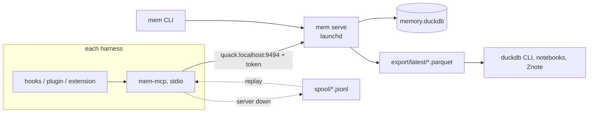

# agent-memory architecture

One local, shared, auditable memory database for AI coding agents, built on
DuckDB 2.0. Every harness writes to the same append-only ledger, so for any
answer an agent gave you can ask: what was it shown, where did that come from,
and what did it do next.

Inspirations: Karpathy's "LLM wiki" idea (curated, human-readable memory that
compounds), duckbrain (DuckDB as an agent brain), and the episodic events /
profile facts / retrieval log split in `example-memory-db-schema.sql`.

This document describes what is built. The project's terms are defined in
[GLOSSARY.md](../GLOSSARY.md). Planned work, known defects, and open
questions are in [roadmap.md](roadmap.md). Decisions a reader would
otherwise wonder about are recorded under [adr/](adr/). Each subsystem has
its own spec: [capture and in-session tools](phase-1-spec.md), [lifecycle,
coverage, and attribution](logic-hardening-spec.md), [the judge
experiment](judge-experiment-spec.md), and [admission](admission-spec.md).

## Harnesses

| Harness          | Tier | Integration           | Capture                                                     |
|------------------|------|-----------------------|-------------------------------------------------------------|
| Factory Droid    | A    | `hooks.json` + MCP    | Lifecycle and tool hooks in real time; assistant replies from the transcript file hooks point at. |
| Mistral Vibe     | A    | `hooks.toml` + MCP    | Tool hooks in real time; prompts and replies from the transcript file. No session or compaction hooks. |
| oh-my-pi (omp)   | A    | TypeScript hooks + MCP | Complete: every message, turn, tool, and compaction event, in process. |
| Amp              | B    | plugin API + MCP      | Complete per turn (`agent.end` carries every message); no compaction or session-end events. Threads also live server-side. |
| JetBrains Junie  | C    | MCP only              | Only what the agent logs through MCP tools. Sessions are `capture_completeness = 'partial'`. |

The tier is stored on `agents` and describes capability, not observed
coverage. Only Droid transcript import and Droid/Vibe hook payload adapters
are shipped; the wider table describes planned integrations.
`capture_observations` supplies bounded coverage evidence.
`session_summary` keeps recorded completeness separate from observed coverage.
Any registered agent can use the `mem-mcp` tools today. The adapters still
to build are in [roadmap.md](roadmap.md#phases).

## Runtime

- `mem serve` is the only process that opens `memory.duckdb`. It calls
  `quack_serve` on localhost, then locks itself down (below). It also writes a
  Parquet snapshot every 24 hours, because it holds the only connection.
- Clients attach with `ATTACH 'quack:localhost:9494' AS mem (TOKEN ...)` and
  run statements on the server. Many clients can write at once; each
  transaction is atomic across tables. Two kinds of client: harness hooks
  call the `mem` CLI directly (`mem event`, `mem ingest`; cold start to answer
  is about 110 ms, well inside Droid's 60 s default hook timeout), and
  `mem-mcp` exposes recall, remember, cite, review, relate, graph, and status
  to the agent mid-session. Both fall back to `spool/` when the server is
  unreachable.
- Admin work (migrations, direct export, `mem sql --direct`) opens the file
  directly and needs the server stopped. DuckDB's file lock enforces this and
  the CLI explains it.
- Parquet exports are the offline path: auditing, notebooks, and backups never
  need the server or the token.

Measured on the development machine during Phase 0: about 4 to 5 ms per
single-row insert over Quack, by `mem smoke`.

## Capture

Specified in [phase-1-spec.md](phase-1-spec.md). One
normalised *capture record* (JSONL) feeds a shared pipeline: redaction, blob
spill over 16 KiB, deterministic ids (`uuid5` over agent, harness session,
kind, and source key), pre-read plus insert in one transaction, or the spool
when the server is down. `mem event --harness droid|vibe` takes one hook
payload on stdin; `mem ingest --transcript` imports a Droid session file
(every entry type mapped; thinking opt-in); `mem ingest --spool` replays, and
`mem serve` drains the spool at startup. A record the ledger rejects, or a
spool line it cannot read, becomes a `capture_error` event and is kept under
`spool/failed/` while the rest of its batch is written. A real 1000-event
transcript imports in about 0.8 s and re-imports in 50 ms. The Vibe
transcript adapter is a stub until a real file exists (see
[roadmap.md](roadmap.md#phases)).

## In-session tools

`mem-mcp` (stdio, `mcp>=2`) offers `recall`, `remember`, `cite`, `review`,
`relate`, `graph`, and `status`. A recall writes a `memory_recall` event, a
`retrievals` row, and one `retrieval_items` row per memory returned with its
`status_at_recall`, and returns a `retrieval_id` for `cite`. Its strategy is
`fts_bm25_v1` for a query, `recent_v1` for an empty query, and
`graph_hop_v1` for a walk of relations with `graph`. `remember` and `review`
write a `memory_write` event; `remember` dedupes on `(scope, content_hash)`
with a `confirm` action. When the server is down, `recall` answers
`degraded`, and `remember` and `review` queue a spool record that replay
turns into the real memory or action.
`AGENT_MEMORY_AGENT` names the agent; `AGENT_MEMORY_SESSION` shares the
ledger session with hooks when the harness can pass it, otherwise the server
opens its own `partial` session.

The capture writer, these tools, `mem graph`, and admission take their
session and event rows from one module, `capture/session.py`. A session is
therefore the same row whether it is opened online or from the spool, and
every event's content is hashed, measured, and moved to a blob by one rule.

## Data model

Every table is append-only. Nothing is ever updated or deleted, so the
database is its own audit log. Migration 0001 created the tables and views
below unless a later migration is named.

Vocabulary (seeded by migrations, not writable by clients):
`agents`, `event_kinds`, `memory_types`, `memory_action_types`.

Ledger:

- `sessions`: one row per session (a conversation in a harness, a judge
  run, a day of admission, or a `mem graph` command), with agent, model,
  project, cwd, `capture_completeness`, and a `VARIANT` metadata column.
- `events`: everything that happened, ordered by `seq` within a session.
  Kinds include `user_msg`, `assistant_msg`, `system_context`, `tool_call`,
  `tool_result`, `memory_recall`, `memory_write`, `compaction`, `decision`,
  `outcome`, and `capture_error`. Large content goes to `blobs/` with
  `blob_ref`, `content_hash`, and `truncated`. `redactions` counts what the
  spool scrubbed. `parent_event_id` links results to calls.
- `capture_observations` (0003): what a capture run actually covered in a
  session: source mode, covered range, parse errors, and exclusions.
  Coverage is read from these rows, not inferred from the agent's tier.

Memory:

- `memories`: curated statements with `scope`, `type`, `key`, `confidence`,
  `importance`, `trust_level` (`user`, `agent`, `tool`, `imported`), validity
  and expiry times, and `supersedes` for corrections.
- `memory_sources`: which events a memory came from (`user_stated`,
  `derived_from`, `supports`, `contradicts`).
- `memory_actions`: review history (`quarantine`, `approve`, `retire`,
  `confirm`, `flag_contradiction`, and from 0002 `propose_correction` and
  `merge_lineage`), with actor and reason.
- `memory_deduplications` (0002): a memory recorded as a duplicate of a
  canonical memory.
- `memory_replacements` (0002): an accepted correction. Only this row marks
  the predecessor superseded.
- `memory_correction_work` and `memory_correction_closures` (0002): proposed
  corrections due for acceptance, and the record that closes each one.
  Clients cannot insert correction work; a ledger trigger does.

Retrieval provenance:

- `retrievals`: each recall, with query, scopes, strategy, SQL, params,
  candidate and returned counts, latency.
- `retrieval_items`: each ranked result, its score breakdown, whether it was
  injected into context, and its status at recall time.
- `context_links`: what an answer was based on. A link points at a retrieval,
  a cited memory, or a context event (for example an injected AGENTS.md).
  `link_id` gives each link a stable identity so a replayed capture can skip
  what it already wrote.
- `answer_bindings` (0004, allowed across sessions by 0006): which captured
  reply a `cite` placeholder turned out to be. A later binding can supersede
  an earlier one.

Replay safety: `sessions` is unique on `(agent_id, harness_session_id)`,
because harnesses fire their "session start" hook more than once per session
(resume, clear, after compaction). `events.seq` is the capturer's best-effort
order; hooks can run concurrently, so audits order by `(ts, recorded_at)`.

Derived views:

- `memory_status`: current status of each memory, one of `retired`,
  `deduplicated`, `superseded`, `expired`, `quarantined`, `pending`, or
  `active`, checked in that order. `pending` covers a future `valid_from`
  and a correction that has not been accepted. A proposed correction does
  not hide its predecessor. Memories with `trust_level = 'tool'` require
  approval; confirmation does not approve.
- `active_memories`: what recall may return.
- `memory_eligibility` (0002): the status a memory has on its own merits,
  before an unaccepted correction marks it `pending`.
- `memory_proposal_status` (0002): each proposed correction as `accepted`,
  `conflict`, or `pending`, with the reason a pending one is waiting.
- `memory_history`: one feed of creations, supersessions, and review actions.
- `session_summary`: per-session counts of answers, recalls, compactions, and
  capture errors, plus capability tier and separately observed coverage.
  Placeholders are not counted as captured replies.
- `why_answer`: for an answer event, every retrieval item, cited memory, and
  context event behind it, each memory's source events and agent, its status
  at recall, and its status now.
- `effective_answer_bindings` and `effective_context_links` (0004): the
  latest binding for each placeholder, and the context links resolved
  through it.

Full-text search: an incremental FTS index on `memories(content, key)`.

Relation graph (no schema change): a relation is a `fact` memory whose `key`
is the normalized triple `subject|predicate|object` and whose `metadata.graph`
holds the display names, entity types, and aliases merged into either end.
`mem-mcp` records them with `relate` and walks them with `graph`, a recursive
CTE over `active_memories` logged as strategy `graph_hop_v1`. Entity resolution
(`mem graph resolve`) reads the relations as a `graph_relations_v1` retrieval,
proposes clusters with a local Ollama model and records
each merge as a superseding row or a `retire` action, so the graph has the same
provenance, status derivation, and `why_answer` coverage as every other memory.
This is the first step of the knowledge-graph layer from Anthropic's cookbook,
adapted to the ledger: extraction is done by the harness agent itself, storage
is append-only, and resolution never rewrites a row. Dedicated `entities` and
`relations` tables are deferred until the trial shows the graph earns them.

## Security model

- Local only. The server listens on localhost, and `AGENT_MEMORY_HOST` must be
  a loopback address.
- One bearer token in `~/.agent-memory/token`, mode 0600. The data directory is
  0700. The CLI refuses a token file that other users can read.
- Every client statement passes the `mem_authorize` macro. It strips quoted
  literals and identifiers, then allows only `SELECT`, `WITH`, `FROM`,
  `DESCRIBE`, `SHOW`, `EXPLAIN`, `SUMMARIZE`, transaction control, and
  `INSERT` into the thirteen client-writable tables. It rejects comments,
  dollar quotes, `E''` strings, multiple statements in one text, DDL,
  `UPDATE`, `DELETE`, `COPY`, `SET`, `CALL`, `PRAGMA`, `ATTACH`, `query()`,
  and `quack_*` functions.
- After `quack_serve` starts, the server sets `allowed_directories` to the
  export directory, turns off extension autoload and autoinstall, sets
  `enable_external_access = false`, and then `lock_configuration = true`.
  Clients cannot read files even with an allowed `SELECT`, and nobody can
  change those settings.
- The policy applies to both ways a client can reach the server: statements
  run through `CONNECT`, and statements against the attached catalog
  (`INSERT INTO mem.main.agents ...`, `DROP TABLE mem.main.events`, and so
  on). Both are tested.
- Quack on localhost is plain HTTP. The token is a bearer token on the loopback
  interface; it never leaves the machine, and it is not echoed in settings or
  in connection error messages (tested).
- Append-only triggers are the last line: even a direct admin connection cannot
  rewrite history without dropping triggers in a migration.
- The CLI disables local variables in tracebacks, so a crash cannot print the
  token.
- Redaction runs before spool, blobs, and database writes, including observed
  coverage and attribution metadata, and again at replay.

## Verified DuckDB 2.0.0 behavior

Each of these was probed against DuckDB 2.0.0 (CLI and Python wheel) before the
schema was written. The tests pin the ones the design depends on.

| Behavior | Consequence |
|----------|-------------|
| Trigger bodies must be DML; `SELECT` is not allowed. | Guards raise with `INSERT INTO _append_only_guard SELECT error(...) FROM o`. |
| `BEFORE` triggers cannot use transition tables. | Guards are `AFTER ... REFERENCING OLD TABLE ... FOR EACH STATEMENT`. Zero-row updates and deletes pass. |
| A trigger cannot modify its own table ("recursive trigger chain"). | Status cannot be kept in a column updated by triggers. Status is derived in views instead. |
| `INSERT OR IGNORE` and `ON CONFLICT` run as `MERGE`, which fails on tables with triggers. | Idempotent writes pre-read existing ids and insert only the missing rows (below). |
| An `INSERT ... SELECT ... WHERE NOT EXISTS (SELECT ... FROM mem.main.t)` through the attached Quack catalog fails: "multiple streaming scans + insert in the same query are not currently supported". | The writer looks up incoming event IDs and their parent IDs in batches of 500, filters client-side, and inserts. Deterministic ids make a lost race a duplicate-key error, which triggers a re-read and a retry, up to three times. |
| Within one `INSERT` statement, a self-referencing foreign key (`events.parent_event_id`) is checked before the statement's own rows are indexed, so a child in the same statement as its parent fails. | `MemoryClient.insert` accepts ordered `(table, rows)` pairs; the writer sends one statement per parent depth, parents first, all in one transaction. |
| A column alias on `match_bm25(...)` cannot be referenced ("expression has side effects"). | Recall wraps the FTS call in a CTE and joins on it. The FTS tokenizer keeps curly quotes attached to words, so queries are lowercased and stripped of punctuation first. |
| Bound parameters are not forwarded through the attached catalog either (`WHERE x = ?` fails). | Lookups by id use `sql_literal` over validated UUIDs; content never enters SQL text except the recall query, which is literal-quoted and tested against injection. |
| Foreign keys (including self-references) work with the guards, and are checked before `AFTER` triggers. | FKs are on. Changing a referenced row fails with a foreign-key error before the guard fires; both reject it. |
| Incremental FTS triggers coexist with the guards; a UUID key works. | FTS on `memories` with `incremental = 1`. |
| `ALTER TABLE ... ADD COLUMN` works on guarded tables and keeps the guards. | Future migrations can add columns. |
| `VARIANT` round-trips through Parquet and over Quack. | Payload and metadata columns are `VARIANT`. |
| Quack does not forward bound parameters, and `RETURNING` does not work for Quack inserts. | The client stages rows in a local temp table with normal parameters, then runs `INSERT INTO mem.main.t SELECT ... FROM stage`, which Quack streams as data. Values never appear in SQL text. |
| The Python client splits a multi-statement string and sends each statement separately. | Each statement is authorized on its own, so a denied statement cannot ride behind an allowed one. Earlier statements in the batch still run. |
| `now()` is fixed per transaction, and `uuidv7()` is not monotonic within a millisecond. | Review order uses `(created_at, rowid)`. On append-only tables `rowid` follows insertion order within a transaction and commit order across transactions. |
| `enable_external_access`, `allowed_directories`, and `lock_configuration` can be set after `quack_serve`. | Lockdown happens after the listener is up. |
| The Python client needs `pytz` to fetch `TIMESTAMPTZ`. | `pytz` is a dependency. |

## Operations

- Install the service with `scripts/com.agent-memory.serve.plist` (see the
  [README](../README.md)). launchd sends SIGTERM on unload; the server stops
  Quack, checkpoints, and closes the file.
- Migrations: stop the service, run `mem migrate`, start it again. Applied
  migrations are checksummed and immutable; edits require a new migration.
- Backups: the daily Parquet snapshot in `export/<timestamp>/`, with
  `export/latest` pointing at the newest. The server keeps the newest 14
  (`--export-keep`). A failed export is logged and retried at the next
  interval; it does not stop the server. A snapshot holds the ledger as it
  was at one moment. The server, and `mem export --direct`, copy every
  table in one transaction. `mem export` through a running server cannot
  hold the tables still, because each statement a client sends sees the
  server as it is then. It counts every table in one statement after
  copying them, which is enough because the tables only grow, copies them
  again if one grew meanwhile, and after three tries publishes nothing and
  exits 1. A file copy of `memory.duckdb` is only consistent while the
  server is stopped.
- While it serves, `mem serve` also applies corrections that have come due,
  once a second. A failed pass, like a failed export, is printed with the
  name of the step and tried again; neither stops the server.
- Health: `mem smoke --live` runs read-only checks against the running server.
  `mem spool status` shows what is waiting for the server and what it
  rejected; `mem ingest --spool` replays the waiting records (the server
  also does this at startup). Rejected records are kept under
  `spool/failed/` and recorded as `capture_error` events; `mem spool retry`
  returns them to the spool.
- Redaction runs in the capture pipeline (`agent_memory.capture.redact`),
  before the spool and before the ledger, and again at replay so a rule added
  later still covers queued records. The server token is always a rule.

## Migrations after 0001

See [logic-hardening-spec.md](logic-hardening-spec.md) for the approved
transition rules and
[memory-utility-evaluation-spec.md](memory-utility-evaluation-spec.md) for
the design-only usefulness study.

- Migration 0002 separates correction proposal from durable acceptance,
  preserves queued identities through deduplication links, and records due
  work without reviving withdrawn predecessors.
- Migration 0003 adds append-only capture observations and bounded coverage.
- Migration 0004 adds correctable answer bindings and keeps retrieval misses
  in the answer audit. Historical retrieval status snapshots remain intact.
- Migration 0005 registers the `judge` agent, so that a verdict is recorded
  as a machine's decision, and removes `memory_correction_work` from the
  tables a client may insert into.
- Migration 0006 lets an answer binding join a placeholder and a captured
  reply that belong to different harness sessions.
- Migration 0007 registers the `admission` agent, so that admission no
  longer writes as `judge`
  ([ADR 0009](adr/0009-admission-writes-as-its-own-agent.md)).
- `mem audit check` provides read-only, ID-based preflight diagnostics,
  including an old-schema direct mode. Live rollout requires separate
  approval and a verified backup including blobs.
- Judge v4 adds exact-rule support and draft-specific admission ground truth.
  Its release is separate from schema migration; finish existing labeling
  with the prior application version first.
